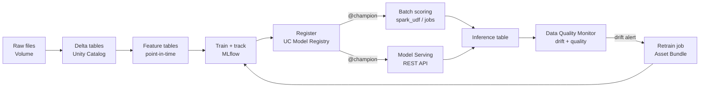

# Module 10 — Wrap-Up: The Whole Game, the Lakehouse Way

> 🎯 **Learning objectives**
> - Revisit the eight production questions from Module 01 and answer each in one sentence
> - See the complete lifecycle on one page
> - Know where to go next: AutoML, the Databricks Assistant, and MLflow Tracing for GenAI
>
> ⏱ **Time:** 15 minutes

---

## 🗺 The map, revisited

This morning, every one of these questions got the answer *"I don't know."* Here's the answer now:

| # | Question | Answer today | Module |
|---|---|---|---|
| 1 | Where did the data come from? Which version? Will it scale? | Delta tables in Unity Catalog with lineage, history, and time travel; Spark for any size | [02](02-data-in-the-lakehouse.md) |
| 2 | Which params, code, and metrics produced the model? | Every run is in MLflow, including the dataset version | [03](03-training-that-remembers.md) |
| 3 | Is scoring using the same preprocessing as training? | Yes, because preprocessing is inside the pipeline artifact | [04](04-pipelines-not-scripts.md) |
| 4 | Do we have to rewrite scikit-learn to scale? | No: `applyInPandas` for many models, `spark_udf` / `mapInPandas` for many rows | [05](05-scale-out-sklearn.md) |
| 5 | Why does every team compute features differently? | Feature tables, point-in-time lookups, models that fetch their own features | [06](06-feature-store.md) |
| 6 | Which model is live? Can we roll back? | `@champion` alias in Unity Catalog; rollback is one line | [07](07-ship-it-with-governance.md) |
| 7 | Is it still accurate? When do we retrain? | Drift and quality monitors; retrain on evidence, not on a calendar | [08](08-keep-it-healthy.md) |
| 8 | How do we get to production safely? | Asset Bundles: one definition, dev/staging/prod targets, CI/CD | [09](09-notebook-to-production.md) |

---

## 🔄 The lifecycle on one page



Every box is governed by the **same** Unity Catalog permissions, and every arrow is captured as **lineage**. That's the real difference from the legacy platform. It isn't any single feature; it's that all the pieces know about each other.

---

## 🚀 Where to go next

### AutoML: a strong baseline in minutes

Before hand-tuning anything, let **AutoML** try. Go to **Experiments → Create AutoML experiment**, pick `customer_features`, set the target to `churned`, and start. It trains and tunes several model families, logs every trial to MLflow, and generates an **editable notebook** for the best model. The generated code is a good template, and the leaderboard is an honest baseline to beat.

> ⚠️ **Compute requirement.** On serverless, AutoML supports only **forecasting**. Classification and regression, like this churn problem, need a **classic cluster** running **Databricks Runtime ML** in **dedicated (single user) access mode**. That's why it's a pointer for later and not a hands-on step today.

### The Databricks Assistant: AI in every cell

Press **Cmd/Ctrl + I** in a cell and ask, for example, *"add a feature for the number of distinct channels used in 90 days"* or *"why did this cell fail?"*. The Assistant knows your tables, their columns, and the error in front of you. Use it to write the boilerplate so you can spend your time on the modelling decisions.

### MLflow Tracing: when your model becomes an agent

Today was classical ML. When the bank builds GenAI applications, such as a retention assistant that reads the churn score, looks up the customer, and drafts an offer, MLflow **Tracing** records every step: inputs, outputs, latency, and errors. It's the same MLflow and the same experiment. Here's a taste:

```python
%pip install -q "mlflow>=3.1"
```

```python
dbutils.library.restartPython()
```

```python
import re, mlflow
CATALOG = "ml_workshop"
user = spark.sql("SELECT current_user()").first()[0]
SCHEMA = re.sub(r"[^a-z0-9_]", "_", user.split("@")[0].lower())
mlflow.set_experiment(f"/Users/{user}/churn_workshop")

@mlflow.trace(span_type="TOOL")
def get_churn_risk(customer_id: str) -> float:
    row = spark.table(f"{CATALOG}.{SCHEMA}.churn_scores").filter(f"customer_id = '{customer_id}'").first()
    return round(row.p_churn, 3)

@mlflow.trace(span_type="CHAIN")
def retention_assistant(customer_id: str) -> str:
    risk = get_churn_risk(customer_id)
    offer = "personal call + fee waiver" if risk > 0.6 else "app voucher" if risk > 0.3 else "no action"
    return f"Customer {customer_id}: churn risk {risk:.0%} → {offer}"

top = spark.table(f"{CATALOG}.{SCHEMA}.churn_scores").orderBy("p_churn", ascending=False).first().customer_id
retention_assistant(top)
```

**What to point out**
- The output cell shows a **trace**: the parent `retention_assistant` span with the `get_churn_risk` tool call nested inside, each with inputs, outputs, and timing.
- In a real agent, the spans would be LLM calls, retrievals, and tool calls. Tracing, evaluation, and monitoring for GenAI build on everything you learned today.

---

## 🧹 Clean up (optional)

```python
CLEANUP = False      # 👈 set to True to delete everything you created today

if CLEANUP:
    from databricks.sdk import WorkspaceClient
    w = WorkspaceClient()
    try:
        t = w.tables.get(f"{CATALOG}.{SCHEMA}.churn_inference_log")
        w.data_quality.delete_monitor(object_type="table", object_id=t.table_id)
    except Exception as e:
        print(f"No monitor to delete ({e})")
    spark.sql(f"DROP SCHEMA IF EXISTS {CATALOG}.{SCHEMA} CASCADE")   # tables, volumes, models
    print("Schema dropped. Also run: databricks bundle destroy -t dev")
```

---

## 📚 Keep learning

- [Cheat sheet: legacy → Databricks](../docs/cheat-sheet.md), a one-page summary of today
- [Glossary](../docs/glossary.md), every term from today in one sentence each
- Databricks Academy: *Get Started with Databricks for Machine Learning*, then *Machine Learning with Databricks*
- Docs: [MLflow on Databricks](https://docs.databricks.com/aws/en/mlflow/) · [Feature Engineering in Unity Catalog](https://docs.databricks.com/aws/en/machine-learning/feature-store/) · [Data quality monitoring](https://docs.databricks.com/aws/en/data-governance/unity-catalog/data-quality-monitoring/) · [Asset Bundles](https://docs.databricks.com/aws/en/dev-tools/bundles/)

---

**Check your understanding**

> *If you had to explain to your manager in one sentence what changed today, what would it be?*
>
> We didn't change the model, which is still scikit-learn. We changed everything *around* it: the data, experiments, features, models, monitoring, and deployments are now versioned, governed, connected by lineage, and automated, so every production question has an answer.

---

[← Module 09 — From Notebook to Production](09-notebook-to-production.md) | [Back to README](../README.md)
